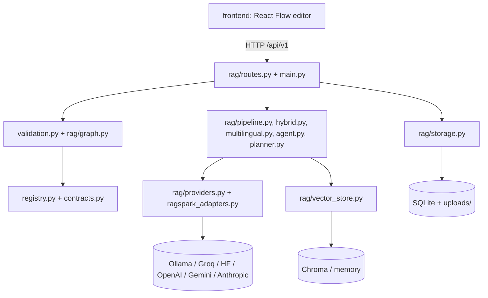
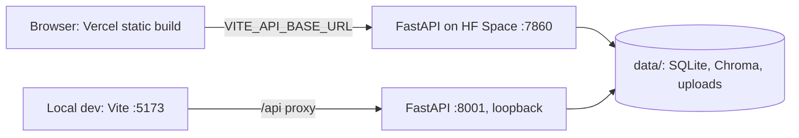

# Architecture Spine — Visual RAG Studio

Fast-path draft: items marked `[ASSUMPTION]` were inferred from code and need your confirmation.

## Design Paradigm

Registry-driven modular monolith. The backend registry (`backend/app/registry.py`) is the single source of truth for catalog, node types, ports and statuses. The frontend renders it and never copies it. Workflows are declarative graphs (`contracts.py`) that `validation.py` checks without executing. Execution is done by fixed runners in `backend/app/rag/`, which are not a generic DAG engine. Providers sit behind adapters.



Dependencies point downward only. `registry`, `contracts` and `validation` import nothing from `rag/`.

## Invariants & Rules

### AD-1 — Registry is the single catalog and contract authority [ADOPTED]
- **Binds:** registry, validation, frontend, docs
- **Prevents:** a second copy of node types or statuses drifting from the backend
- **Rule:** Add node types, ports and architecture entries only in `registry.py`. The frontend reads `/api/v1/registry` and holds no catalog copy. Graph serialization carries only node ID, `node_type_id`, config and provider reference, with no canvas coordinates.

### AD-2 — Truthful status gates execution [ADOPTED]
- **Binds:** registry, validation, routes, UI
- **Prevents:** planned or unverified capabilities running or being advertised as runnable
- **Rule:** `planned < experimental < implemented < tested`. Validation reports `valid` separately from `executable`, and a planned node cannot be executable. A status is promoted only with recorded evidence in the story report.

### AD-3 — Validate before execute, and validation never runs anything [ADOPTED]
- **Binds:** validation, query/ingest routes
- **Prevents:** running unchecked graphs or imported code
- **Rule:** `/workflows/validate` and runners call the deterministic validators and never invoke a model. Only allow-listed node types are accepted. No code, shell, SQL or package install comes from a graph. Execution endpoints (`/query`, `/agent/run`) must re-validate the graph server-side.

### AD-4 — Fixed runners, not a generic executor [ADOPTED]
- **Binds:** pipeline, agent, hybrid, multilingual
- **Prevents:** two diverging execution engines
- **Rule:** Architecture behaviour lives in explicit runner modules. `/query` dispatches to the agent runner only when `agent.orchestrate` is in the graph, otherwise to the Traditional/Hybrid pipeline. A new architecture family extends the registry plus a runner, and does not fork `/query`. `[ASSUMPTION]` Hybrid, Reranking and Multilingual are configurations of shared nodes.

### AD-5 — Two stores, with defined ownership [ADOPTED]
- **Binds:** storage, vector_store, routes
- **Prevents:** chunk text or provenance being written to the wrong place
- **Rule:** `DocumentStore` (SQLite via SQLAlchemy, plus `uploads/`) owns document identity, ingestion state, profile, selection, chunk index metadata, saved workflows and revisions, and run records. The vector adapter (Chroma persistent, or in-memory) owns vectors, chunk text and provenance metadata. Chunk text is not duplicated into SQLite. Run records (question, answer, citations, per-node trace, provider and model) are persisted only for comparison and history (Epic 3), contain no secrets, and are user-deletable. Live execution progress stays in the in-process `ExecutionTracker` (bounded to 64 runs). Amended from "queries and answers are not persisted" when run history was added.

### AD-6 — Embedding model and dimension are pinned per collection [ADOPTED]
- **Binds:** vector_store, ingestion, planner
- **Prevents:** mixed-dimension corruption and silently wrong retrieval
- **Rule:** The vector adapter records `embedding_model` and `embedding_dimension` and refuses a mismatched write or query. Reindexing upserts the new vectors first, then removes stale ones. Chunk IDs are deterministic, so retries are idempotent.

### AD-7 — Provenance and abstention are non-negotiable [ADOPTED]
- **Binds:** pipeline, agent, multilingual
- **Prevents:** invented citations or ungrounded answers
- **Rule:** Every answer cites retrieved chunk IDs and the pipeline validates citation IDs. Insufficient evidence yields a deterministic, localized abstention. Context assembly keeps whole chunks within `max_context_chars`.

### AD-8 — Explicit providers, no silent fallback [ADOPTED]
- **Binds:** providers, routes, config
- **Prevents:** hidden provider switching, silent mocks, surprise external data egress
- **Rule:** Each request names its generation provider and model. Provider failures surface as typed errors. Hosted providers receive document excerpts only after explicit per-query authorization, and the provider must pass the "Test provider" call first. `[ASSUMPTION]` `extractive` and `fast_local` are explicit options and not fallbacks.

### AD-9 — Secrets never reach graphs, traces, storage or responses [ADOPTED]
- **Binds:** config, credentials, routes, frontend
- **Prevents:** credential leakage
- **Rule:** Keys come from env as `SecretStr` or from `RuntimeCredentials` (process-local memory). Routes expose configured/not-configured only. The frontend must not persist keys. `[ASSUMPTION]` Vector-node config fields like `api_key`/`url` (`routes.py` /query) are an exception that must be reviewed, because they put a secret in graph JSON.

### AD-10 — Bounded agent behaviour [ADOPTED]
- **Binds:** agent.py, planner.py
- **Prevents:** runaway loops and unbounded tool use
- **Rule:** The agent runs only tools in `allowed_tools`, within `max_steps`, `max_retrieval_iterations`, `token_budget` and `timeout_seconds`. Each step emits a structured trace entry (planning, retrieval, rerank, evaluate_evidence, reformulate_query, answer_generation, abstain).

### AD-11 — Loopback-only until an auth boundary exists [ADOPTED, VIOLATED IN DEPLOY]
- **Binds:** config, deployment
- **Prevents:** exposing an unauthenticated API
- **Rule:** `Settings` rejects a non-loopback `VRS_HOST`. Any hosted deployment must add an API-key or session boundary and a restricted CORS allow-list before it is considered supported. Current state: CORS allows any origin with credentials (`main.py`), and the Docker/Space entrypoints bind `0.0.0.0`. This is flagged as an open conflict.

### AD-12 — API key flow for hosted use [ASSUMPTION]
- **Binds:** frontend `api.ts`, `main.py` auth dependency, deployment
- **Prevents:** shipping the API key in the static frontend bundle, or storing it in the browser
- **Rule:** The backend checks an `X-API-Key` header against `VRS_API_KEY` on every `/api/v1` route, with `/api/health/*` open. The frontend never reads the key from a `VITE_` variable. The user enters it in the UI, it is held in session memory only (never `localStorage`), and `apiFetch` attaches it to requests. Loopback development with no `VRS_API_KEY` set runs without it.

## Consistency Conventions

| Concern | Convention |
| --- | --- |
| Naming | Node types `domain.action` (e.g. `retrieval.dense`, `merge.fuse`, `agent.orchestrate`); architecture IDs kebab-case (`hybrid-rag`); env vars `VRS_*` |
| API | `/api/v1/...` for resources, `/api/health/{live,ready}` for health; errors `{detail:{code,message}}` via `PipelineError` |
| Data | Pydantic v2 models at the API boundary; IDs are deterministic for chunks, opaque for documents and workflows |
| State | Mutate stores only through `DocumentStore` and the vector adapter, never directly in routes; dependency providers come from `rag/dependencies.py` |
| Testing | Backend tests in `backend/tests` (pytest, `uv run`); frontend `vitest`; provider-gated tests are opt-in and reported separately; no mocks claimed as live evidence |

## Stack

| Name | Version |
| --- | --- |
| Python | >=3.11,<3.15 (Docker image: 3.12) |
| FastAPI / uvicorn | >=0.120 / >=0.38 |
| Pydantic / pydantic-settings | >=2.12 / >=2.11 |
| SQLAlchemy (SQLite) | >=2.0 |
| ChromaDB | >=1.0,<2 |
| sentence-transformers | >=5.1 (default `paraphrase-multilingual-MiniLM-L12-v2`, 384d) |
| PyMuPDF | >=1.26 |
| ragspark | git, unpinned in pyproject; pinned to a commit in the Dockerfile |
| React / Vite / TypeScript | ^19.1 / ^7.1 / ~5.9 |
| @xyflow/react | ^12.8 |
| vitest | ^3.2 |

Versions come from manifests and were not web-verified.

## Structural Seed



```text
backend/app/        registry, contracts, validation, config, main
backend/app/rag/    routes, pipeline, graph, storage, vector_store, providers, hybrid, multilingual, agent, planner
backend/tests/      pytest suites
frontend/src/       VisualBuilder.tsx (editor), api.ts (base-URL client)
docs/               planning and story reports
```

## Capability → Architecture Map

| Area | Lives in | Governed by |
|---|---|---|
| Catalog / registry / validation | `registry.py`, `validation.py` | AD-1, AD-2, AD-3 |
| Ingestion and chunking | `rag/pipeline.py`, `chunking.py`, `planner.py` | AD-5, AD-6 |
| Retrieval (dense, BM25, RRF, rerank) | `rag/hybrid.py`, `vector_store.py` | AD-4, AD-6 |
| Multilingual | `rag/multilingual.py` | AD-7 |
| Agent | `rag/agent.py` | AD-4, AD-10 |
| Providers and secrets | `rag/providers.py`, `credentials.py` | AD-8, AD-9, AD-12 |
| Deployment | `vercel.json`, `backend/Dockerfile`, `space_app.py` | AD-11 |

## Deferred

- Authentication, tenancy and a hosted threat model. Revisit before any shared deployment (see AD-11).
- Saved-workflow revisions, branch/compare and template publishing. `/workflows` currently stores one graph per record.
- Run-record retention policy (age or count limits). Add if storage growth becomes a problem; deletion controls exist from Story 3.2.
- Generic graph executor / LangGraph. Add only when stateful branching beyond the fixed runners is required.
- RagSpark integration status. `[ASSUMPTION]` it is partly integrated (`ragspark_adapters.py`, reranker), which conflicts with the older Story 7 report.
